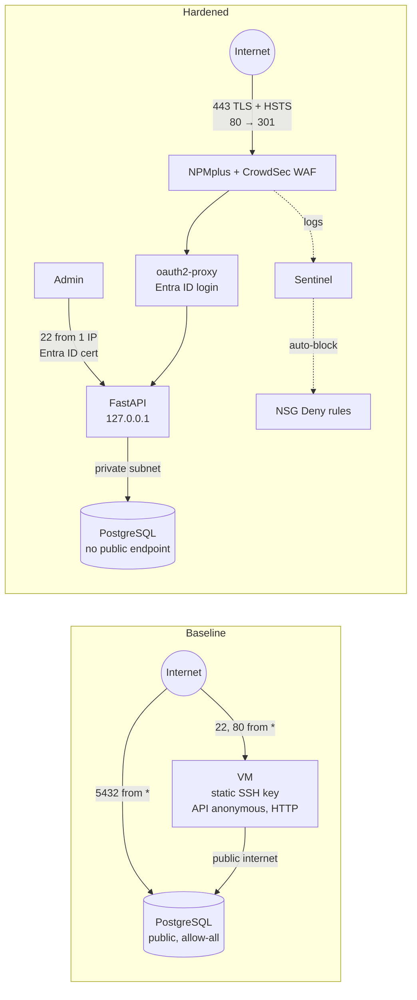

# LearningSteps — Hardened Azure Deployment

A Terraform deployment of the [LearningSteps](https://github.com/CyberstepsDE/learningsteps) API (FastAPI + PostgreSQL) on Azure. It started as an **intentionally insecure "Base Deployment"** and was hardened layer by layer over five days. Every change was verified on a live deployment.

- Course walkthrough: [handbook.md](handbook.md)
- Security documentation: [Security Hardening](#security-hardening) below and the [`security/`](security/) folder
- Full command history with real output: [security/walkthrough-log.md](security/walkthrough-log.md)

## Project Summary

### Before → after



| Layer | Baseline | Hardened | Verified by |
|---|---|---|---|
| Management | SSH from `*`, static key | SSH from one IP; Entra ID login, ~1 h certificates, per-person audit | `nc` from Cloud Shell → timeout; `whoami` = Entra UPN |
| Transport | HTTP in cleartext | Let's Encrypt TLS, Force HTTPS, HSTS 2 y | `http` → 301; `https` → HTTP/2 200, trusted cert |
| Application input | no inspection | CrowdSec AppSec + OWASP CRS (in-band) | SQLi / XSS → 403; normal request → 200 |
| Identity | anonymous read/write/delete | Entra ID (OIDC) via oauth2-proxy + NPMplus Auth Request | no login / fake token → 302; browser login → data |
| Data | DB reachable from the internet | delegated subnet, private DNS, no public endpoint | `nc` to 5432 → name does not resolve |
| Detection & response | none | Sentinel rule → incident → Logic App → NSG Deny | real scanner auto-blocked; controlled test blocked (`000`) |

### Real-world events during the project

- **A real attacker within minutes:** ~20 minutes after the HTTPS certificate was issued, a scanner (`45.45.237.39`) sent 24 LFI probes. The WAF blocked them, CrowdSec banned the IP, and Sentinel + the playbook added an NSG Deny rule. No human was involved.
- **A controlled second attack** (Azure Cloud Shell) exposed a bug in the response chain, which was then fixed and re-verified.

### Bugs found in the base deployment and fixed

| # | Problem (found live) | Impact | Fix |
|---|---|---|---|
| [#2](https://github.com/someson/learningsteps-terraform/pull/2) | VM size `Standard_D2s_v3` not available (`SkuNotAvailable`) | deployment fails | `vm_size` variable, default `D2s_v6`, NVMe auto-detected |
| [#5](https://github.com/someson/learningsteps-terraform/pull/5) | 12 bogus changes in every `terraform plan` | real drift invisible | ignore only Azure's `created-on` tag; template matches Azure's stored form |
| [#9](https://github.com/someson/learningsteps-terraform/pull/9) | inline NSG rules → `apply` deletes Sentinel's block rules | known attacker re-admitted | standalone `azurerm_network_security_rule` + import |
| [#11](https://github.com/someson/learningsteps-terraform/pull/11) | playbook always uses priority 100 → `SecurityRuleConflict` | **only one attacker can ever be blocked** | next free priority, sequential loop |
| [#12](https://github.com/someson/learningsteps-terraform/pull/12) | Azure-added `Microsoft.Storage` endpoint on the DB subnet | `apply` would remove it (backups) | declared in code |
| [#6](https://github.com/someson/learningsteps-terraform/pull/6) | `az ssh config` writes a private key into the repo folder | key could be committed | `.gitignore` |

Found and fixed **manually on the VM** (not yet in the setup scripts): oauth2-proxy env file was world-readable (`chmod 600`); missing `email` claim → HTTP 500 at login (`preferred_username`); redirect whitelist; dpkg lock race in `setup-npmplus.sh` (re-run after cloud-init).

### Findings status (F-01 … F-17)

- ✅ **Mitigated (7):** F-01, F-03, F-04, F-05, F-06, F-07, F-14
- 🟡 **Partially (4):** F-02, F-08, F-11, F-16
- ⏳ **Open (6):** F-09, F-10, F-12, F-13, F-15, F-17

Details are in the [Findings tracker](#findings-tracker).

### What is still open (next steps)

1. **Secrets** (F-09, F-10): the DB admin password is in plaintext in the systemd unit (world-readable), in `custom_data` and in Terraform state, and the app uses the admin account. → dedicated least-privilege DB role; **Key Vault** + managed identity, or **Entra ID auth for PostgreSQL** (no password at all).
2. **Authorization** (F-17): any user of the tenant can sign in, and every user can `DELETE` all entries. → "Assignment required" + group; per-action authorization in the app.
3. **Detection blind spot:** unauthenticated attacks get `302` before the WAF sees them, so the 403-based rule cannot fire. → alert on `302` bursts, run AppSec before `auth_request`, or ship CrowdSec alerts to Sentinel. Now covered by a second Sentinel rule on `CrowdSecAlerts`: CrowdSec's log-based scenarios read `access.log` whatever the status code, and their alerts trigger the same auto-block (see `security/05-detection-response.md`). AppSec itself still does not see these requests.
4. **Manual state:** TLS, WAF, oauth2-proxy and the Entra ID app are configured by hand. → codify (`azuread` provider, setup scripts) or use managed services: Application Gateway / Front Door WAF, App Service authentication.
5. **Supply chain & state** (F-13, F-15): pin `crowdsec:latest`, patch management for the VM (security updates pending at boot), remote Terraform state with RBAC.
6. **Response hygiene:** block rules never expire, and the incidents are still "New". → TTL, allow-list, analyst triage.

## What Gets Deployed

- **Ubuntu VM** (Standard_D2s_v6 by default, configurable via `vm_size`) in `snet-app`, running the FastAPI app (localhost only), NPMplus (reverse proxy + Let's Encrypt), CrowdSec (WAF) and oauth2-proxy
- **Azure PostgreSQL Flexible Server** (B1ms) injected into the delegated subnet `snet-db`, with a private DNS zone and **no public endpoint**
- **NSG** with standalone rules: SSH only from `admin_source_ip`, HTTP/HTTPS from anywhere. Priorities 100–999 are reserved for Sentinel auto-block rules
- **Log Analytics + Microsoft Sentinel**: syslog via Azure Monitor Agent, two analytics rules (WAF 403 volume, CrowdSec alerts), and a Logic App playbook that blocks attacker IPs in the NSG
- **CrowdSec alerts in Sentinel**: `CrowdSecAlerts` KQL function and saved searches (attack type per IP); the VM side is installed by `scripts/setup-crowdsec-logging.sh`
- **VNet flow logs + Traffic Analytics** (`flowlogs.tf`): every flow with the NSG verdict, in `NTANetAnalytics`; saved searches in category *Network* (denied flows per day, top denied IPs)

> TLS, the WAF bouncer, the Entra ID app registration and oauth2-proxy are configured as described in the per-day documents. They are not created by `terraform apply`.

## Security Hardening

This project documents how the intentionally insecure "Base Deployment" is
turned into a hardened, production-ready architecture: what was wrong, what
was changed, how, and how the fix was verified.

### Documents

| # | Document | Status |
|---|---|---|
| — | [Walkthrough log](security/walkthrough-log.md): every command run, problems hit and how they were fixed | ✅ complete |
| 00 | [Baseline security assessment](security/00-baseline-assessment.md): threat model, findings F-01…F-17, roadmap | ✅ done |
| 01 | [Day 1: Management access](security/01-management-access.md) (Entra ID SSH, SSH restricted to a trusted IP) | ✅ done, verified |
| 02 | [Day 2: TLS + Web Application Firewall](security/02-tls-waf.md) (NPMplus, Let's Encrypt, CrowdSec/CRS) | ✅ done, verified |
| 03 | [Day 3: Identity-based API access](security/03-identity-api-access.md) (Entra ID + oauth2-proxy) | ✅ done, verified |
| 04 | [Day 4: Data isolation](security/04-data-isolation.md) (PostgreSQL VNet integration, private DNS) | ✅ done, verified |
| 05 | [Day 5: Detection and response](security/05-detection-response.md) (Sentinel + auto-block playbook) | ✅ done, verified |
| 06 | [Network visibility](security/06-network-visibility.md) (VNet flow logs, Traffic Analytics) | ✅ deployed by Terraform, live verification pending |

### Structure of each day's document

1. **Problem**: which findings from [`security/00-baseline-assessment.md`](security/00-baseline-assessment.md) it addresses
2. **Threat**: how an attacker exploits it
3. **Change**: code diff (Terraform / scripts) or manual steps, with the reason for each
4. **Verification**: before/after commands and their output (e.g. `curl`, `psql`, `nmap`)
5. **Residual risk**: what is still not covered and how the managed Azure service would do it (Bastion, Application Gateway WAF, Key Vault, Private Endpoint, Defender for Cloud)

### Findings tracker

| ID | Short name | Severity | Fixed in |
|---|---|---|---|
| F-01 | SSH open to the internet | High | Day 1 |
| F-02 | Static SSH key only | Medium | Day 1 (partially: key still exists) |
| F-03 | Public DB, firewall allows all IPs | Critical | Day 4 |
| F-04 | VM→DB over the public internet | High | Day 4 |
| F-05 | API without authentication | Critical | Day 3 (authentication; no per-action authorization yet) |
| F-06 | No TLS | High | Day 2 |
| F-07 | No WAF | High | Day 2 |
| F-08 | API bound to 0.0.0.0 at boot | Medium | Partially (rebound to 127.0.0.1 by `setup-npmplus.sh`; port 8000 never opened in the NSG) |
| F-09 | DB password in plaintext (state, custom_data, unit file) | High | |
| F-10 | App uses DB admin account | Medium | |
| F-11 | Default NPMplus admin credentials | High | Day 2 (password changed; default still in script) |
| F-12 | SSH host key verification disabled in deploy.py | Low | |
| F-13 | Unpinned images / dependencies | Low–Medium | |
| F-14 | No detection / response | Medium | Day 5 (403 rule + CrowdSec alert rule, both auto-block) |
| F-15 | Local unencrypted Terraform state | Medium | |
| F-16 | Flat network, VM with public IP | Medium | Day 4 (partially: DB subnet; VM still public) |
| F-17 | oauth2-proxy allows any tenant user | Low–Medium | |

## Prerequisites

Install the following before running the script:

| Tool | Install |
|---|---|
| Python 3.8+ | [python.org](https://www.python.org/downloads/) — on Windows use `python`, on macOS/Linux use `python3` |
| Terraform ≥ 1.5 | [developer.hashicorp.com/terraform/install](https://developer.hashicorp.com/terraform/install) |
| Azure CLI | [learn.microsoft.com/en-us/cli/azure/install-azure-cli](https://learn.microsoft.com/en-us/cli/azure/install-azure-cli) |
| Azure CLI `ssh` extension | `az extension add --name ssh` — required for the handbook's `az ssh` / `az ssh config` commands (Entra ID VM login) |
| Azure subscription | Your account needs **Contributor** or **Owner** role on the subscription |

## Deploy

```bash
python3 deploy.py
```

On Windows:
```
python deploy.py
```

The script will:
1. Log you in to Azure if needed (opens a browser)
2. Generate an SSH key pair in the project folder
3. Ask for a resource prefix and Azure region (IMPORTANT - Make sure your prefix is unique and includes your name, otherwise the deployment will fail due to naming conflicts)
4. Ask for a PostgreSQL admin password
5. Run `terraform apply` — takes about 7–8 minutes
6. Run a smoke test against the deployed API

To skip the interactive prompts:
```bash
python3 deploy.py --password YourPassword1 --prefix learningstepsbob --location westeurope
```

Once deployed, the script prints the API URL and SSH command.

## Stopping and Starting

When not in use, deallocate the VM to avoid compute charges:
```bash
az vm deallocate --resource-group rg-<prefix> --name vm-<prefix>
```

Start it again:
```bash
az vm start --resource-group rg-<prefix> --name vm-<prefix>
```

Stop the database:
```bash
az postgres flexible-server stop --resource-group rg-<prefix> --name psql-<prefix>
```

Start it again:
```bash
az postgres flexible-server start --resource-group rg-<prefix> --name psql-<prefix>
```

> Note: Azure automatically restarts a stopped PostgreSQL Flexible Server after 7 days.

To destroy everything permanently:
```bash
terraform destroy
```

## Troubleshooting

- **`terraform apply` fails with a Sentinel-related resource "already
  exists"** (seen on `azurerm_sentinel_log_analytics_workspace_onboarding.main`,
  `azurerm_sentinel_alert_rule_scheduled.waf_attack`, and
  `azurerm_sentinel_automation_rule.block_attacker`) — happens if you
  `terraform destroy` and then redeploy with the *same prefix* shortly after:
  these Sentinel objects use fixed names (not random IDs) and can take a few
  minutes to clear on Azure's side even though the Log Analytics workspace
  itself is gone. `terraform apply` fails on the first one it hits — expect
  to repeat this for each one in turn (apply, hit next conflict, import,
  re-apply) rather than all three appearing in one error. Fix each by
  importing it into the new state, then re-running apply:
  ```bash
  az account show --query id -o tsv   # get your subscription ID

  terraform import azurerm_sentinel_log_analytics_workspace_onboarding.main \
    "/subscriptions/<subscription-id>/resourceGroups/rg-<prefix>/providers/Microsoft.OperationalInsights/workspaces/law-<prefix>/providers/Microsoft.SecurityInsights/onboardingStates/default"

  terraform import azurerm_sentinel_alert_rule_scheduled.waf_attack \
    "/subscriptions/<subscription-id>/resourceGroups/rg-<prefix>/providers/Microsoft.OperationalInsights/workspaces/law-<prefix>/providers/Microsoft.SecurityInsights/alertRules/waf-attack-scheduled"

  terraform import azurerm_sentinel_automation_rule.block_attacker \
    "/subscriptions/<subscription-id>/resourceGroups/rg-<prefix>/providers/Microsoft.OperationalInsights/workspaces/law-<prefix>/providers/Microsoft.SecurityInsights/automationRules/a1b2c3d4-0000-0000-0000-000000000001"

  terraform apply
  ```
  Avoiding it entirely: use a different prefix, or wait a few minutes after
  destroy before reusing the same one.

- **`SkuNotAvailable` for the VM size** — Azure has no capacity for that
  size in the region right now. Pick another 2-vCPU size that is available:
  ```bash
  az vm list-skus --location westeurope --resource-type virtualMachines \
    --query "[?contains(name,'_D2') && restrictions==\`[]\`].name" -o tsv | sort -u
  ```
  and set it in `terraform.tfvars`, e.g. `vm_size = "Standard_D2as_v5"`.
  `*_v6` sizes automatically get `disk_controller_type = "NVMe"` (`vm.tf`).

## SSH Access

The SSH key is generated in the project folder during deployment:

```bash
ssh azureuser@<vm-ip> -i .learningsteps_key
```

