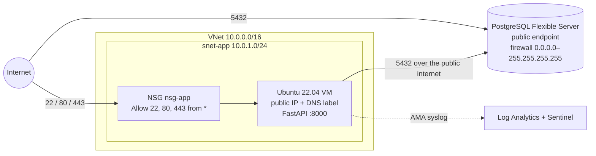

# 00 — Baseline Security Assessment

**Scope:** the "Base Deployment" produced by `deploy.py` + Terraform in this
repository (before any hardening).
**Role:** Lead Security Engineer.
**Method:** manual review of the Terraform code, cloud-init, the VM setup
scripts and `deploy.py`. Each finding links to the file and line that causes it.

## 1. Architecture as deployed

## 2. Assets and threat actors

| Asset | Why it matters |
|---|---|
| Journal entries in PostgreSQL | The business data. Confidentiality and integrity |
| DB admin credentials | Full read/write/drop on all data |
| The VM (OS, root) | Runs the app and holds the DB connection string. Pivot point |
| NPMplus admin panel / TLS keys | Controls routing, certificates and the WAF |
| Azure control plane (RBAC, NSG) | Whoever controls it controls everything above |

Threat actors considered: opportunistic internet scanners and bots (the most
likely), a targeted external attacker, and a user with stolen credentials or a
stolen session.

## 3. Findings

Severity: **Critical**: direct compromise from the internet with no
credentials. **High**: compromise needs little effort or one leaked secret.
**Medium**: weakens defense-in-depth. **Low**: hygiene.

| ID | Finding | Evidence | Severity | Planned mitigation |
|---|---|---|---|---|
| F-01 | SSH (22) is open to the entire internet. It is constantly brute-forced by bots | `network.tf:36` `source_address_prefix = "*"` | High | Day 1: restrict to a trusted IP, Entra ID SSH login |
| F-02 | VM access depends on a long-lived static SSH key on the operator's disk, with no identity, MFA or per-user audit | `vm.tf:33`, `deploy.py` key generation | Medium | Day 1: Entra ID login (`AADSSHLoginForLinux` + RBAC role) |
| F-03 | Database endpoint is public and its firewall allows **every IPv4 address** | `postgresql.tf:18-22` | **Critical** | Day 4: VNet integration, delegated subnet, private DNS, remove `allow_all` |
| F-04 | VM → DB traffic crosses the public internet. TLS is used, but the attack surface is internet-wide | `vm.tf:71` (public FQDN) | High | Day 4 (same fix as F-03) |
| F-05 | API has no authentication or authorization. Anyone can read, create or **delete all** entries (`DELETE /entries` clears the table) | app + `deploy.py` smoke test | **Critical** | Day 3: oauth2-proxy + Entra ID in front of the app |
| F-06 | No TLS for the public entry point (HTTP only) | NSG 80 open, no certificate | High | Day 2: NPMplus + Let's Encrypt, force HTTPS |
| F-07 | No WAF or input inspection. SQLi and XSS payloads reach the app unfiltered | `scripts/setup-npmplus.sh` (bouncer `ENABLED=false`) | High | Day 2: CrowdSec AppSec + OWASP CRS, in-band |
| F-08 | FastAPI starts bound to `0.0.0.0:8000` and is only rebound to localhost later by a setup script | `scripts/cloud-init.yaml:34` | Medium | Bind to `127.0.0.1` in cloud-init directly |
| F-09 | DB admin password in plaintext: in `terraform.tfvars`, in the Terraform **state**, in VM `custom_data` (readable from instance metadata and the Azure API) and in the systemd unit `Environment=` (world-readable) | `vm.tf:71`, `deploy.py:268`, `cloud-init.yaml:33` | High | Key Vault + managed identity, or an `EnvironmentFile` with mode 0600 at minimum. Remote state with restricted access |
| F-10 | App connects as the PostgreSQL **admin** user (no least privilege) | `vm.tf:71` | Medium | A dedicated app role with only the rights it needs on `entries` |
| F-11 | Hard-coded default credentials for the NPMplus admin panel | `scripts/setup-npmplus.sh:91-92` | High (if :81 were ever exposed) | Change on first login, keep :81 reachable only through the SSH tunnel |
| F-12 | `deploy.py` disables SSH host-key verification (MITM possible on first connect) | `deploy.py:117` | Low | Pin the host key / use `az ssh` |
| F-13 | Unpinned dependencies: `crowdsec:latest`, image `version = "latest"`, `git clone` of the default branch | `setup-npmplus.sh:28`, `vm.tf:51`, `cloud-init.yaml:42` | Low–Medium | Pin versions/digests, patch management |
| F-14 | No detection or response: an attack would not be noticed | baseline | Medium | Day 5: Sentinel analytics rule + auto-block playbook (`sentinel.tf`) |
| F-15 | Terraform state kept locally, unencrypted, contains secrets | no `backend.tf` | Medium | Remote `azurerm` backend (`backend.tf.example`) with RBAC |
| F-16 | Flat network: one subnet, the VM has a public IP, and there is no egress filtering | `network.tf` | Medium | DB subnet (Day 4). Optional: Bastion / private-only VM, outbound NSG rules |
| F-17 | oauth2-proxy template accepts any e-mail domain (`--email-domain=*`). Any account in the tenant gets access | `setup-oauth2-proxy.sh:68` | Low–Medium | Restrict to a group or app role assignment ("Assignment required") |

## 4. Attack scenarios (how an attacker exploits the baseline)

1. **Database takeover without touching the VM (F-03, F-09):** scan
   `*.postgres.database.azure.com:5432` → brute-force or reuse the `psqladmin`
   password → dump or drop all data.
2. **Anonymous data destruction (F-05):** `curl -X DELETE http://<vm>/entries`
   needs no exploit at all.
3. **SSH brute force (F-01, F-02):** a VM with a public IP on port 22
   receives login attempts within minutes of creation.
4. **Credential harvesting after VM compromise (F-09, F-10):** any local user
   can read the admin DB URL from `/etc/systemd/system/learningsteps.service`.

## 5. Prioritised remediation roadmap

| Priority | Layer | Findings | Where it is documented |
|---|---|---|---|
| 1 | Data isolation | F-03, F-04, F-16 | Day 4 |
| 2 | Identity at the app layer | F-05, F-17 | Day 3 |
| 3 | Management access | F-01, F-02, F-12 | Day 1 |
| 4 | Transport + WAF | F-06, F-07, F-08 | Day 2 |
| 5 | Detection and response | F-14 | Day 5 |
| 6 | Secrets and supply chain | F-09, F-10, F-11, F-13, F-15 | Extra hardening |

The course goes through the layers in Day 1 → Day 5 order, from the outside
in. The table above ranks them by **risk** instead. This is a deliberate
contrast: in a real incident, the public database and the unauthenticated
DELETE endpoint would be fixed first.
