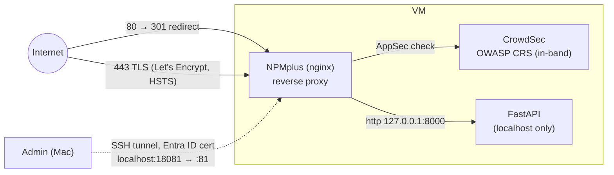

# 02 — Day 2: Encryption and a Web Application Firewall

**Findings addressed:** F-06 (no TLS), F-07 (no WAF), F-11 (default NPMplus
admin credentials). Full command history: [walkthrough-log.md](walkthrough-log.md), Step 5.

## Problem and threat

After the proxy host was created, the app was publicly reachable over plain
HTTP. Every journal entry travelled in cleartext, readable by anyone on the
path (public Wi-Fi, ISP, transparent proxies), and a man-in-the-middle could
change responses. Request content was not inspected either, so SQL-injection
and XSS payloads reached the application unfiltered.

## Architecture after Day 2

## Changes (manual, in the NPMplus GUI / on the VM)

| # | Change | Why |
|---|---|---|
| 1 | Admin GUI reached **only through an SSH tunnel** (`az ssh config` + `ssh -F … -L 18081:localhost:81`). Port 81 is not opened in the NSG | Management interfaces must never be internet-facing. The Entra ID certificate is valid for ~1 h |
| 2 | Default admin password **changed** on first login | `admin@learningsteps.local / LearningSteps123!` is public in the course repository (F-11) |
| 3 | Proxy host `ls-vladi.westeurope.cloudapp.azure.com` → `http://127.0.0.1:8000` | Single, controlled public entry point; the app itself stays on localhost |
| 4 | TLS tab: Let's Encrypt cert, **Force HTTPS**, **HSTS (2 y)**. HTTP/3, HSTS preload and DNS challenge off | Encryption in transit; HSTS prevents SSL-stripping. HTTP/3 would need UDP/443 in the NSG; preload is hard to undo |
| 5 | `cscli bouncers add npmplus` + `crowdsec.conf` `ENABLED=true`, `API_KEY=…` (entered via `read -rs`, never echoed), restart NPMplus | Connects NPMplus to CrowdSec AppSec with the OWASP CRS running **in-band** (blocking), see `scripts/setup-npmplus.sh` |
| 6 | CrowdSec CAPI sharing **kept on** (deliberate) | Community blocklist in exchange for attacker-IP signals; request context is not shared |

## Verification

| Check | Before | After |
|---|---|---|
| `curl -i http://<domain>/entries` | `HTTP/1.1 200`, JSON in cleartext | `301 Moved Permanently` → `https://…` |
| `curl -i https://<domain>/entries` | — | `HTTP/2 200`, trusted cert (no `-k`), `strict-transport-security: max-age=63072000` |
| SQLi `?id=1+UNION+SELECT+*+FROM+users` | `200` | **`403`** |
| XSS `?q=` | `200` | **`403`** |
| Normal request `/entries` | `200` | `200` (no false positive) |

CrowdSec alerts (`cscli alerts list`):
- our two test payloads were classified as `sql_injection` and `xss`
  (anomaly score 40 each);
- **a real attacker**, `45.45.237.39` (US, AS400529), sent ~24 LFI probes
  about 1 minute after the WAF was enabled and ~20 minutes after the
  certificate was issued. CrowdSec banned the IP automatically (`ban:1`).
  New hostnames become public through Certificate Transparency logs, and
  scanners act on them immediately.

## Deviations from `handbook.md`

- NPMplus `2026-06-25-r1` calls the tab **TLS** (not SSL) and has extra options.
- Local port 8081 was in use on the Mac, so the tunnel uses `18081`.
- The bouncer key was written with `read -rs` + `sed` instead of `nano`, so
  it never appears on screen or in shell history.

## Residual risk

- **All of this is manual state on the VM.** It is not in Terraform, so a
  VM rebuild loses it. Production: Azure **Application Gateway WAF v2** or
  **Front Door WAF** (managed OWASP rules, managed certificates) as code.
- The WAF also protects the NPMplus admin interface. Admin calls through the
  tunnel come from `127.0.0.1` and can be flagged (see handbook troubleshooting).
- `crowdsec:latest` is unpinned (F-13).
- The API is still **anonymous**: anyone can read or delete entries (F-05),
  which is Day 3.
- Port 80 stays open for redirects and the HTTP-01 challenge.
