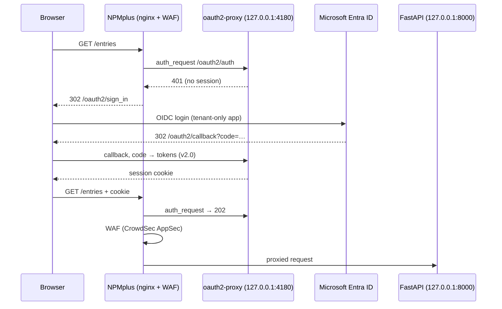

# 03 — Day 3: Identity-Based API Access

**Findings addressed:** F-05 (API without authentication). Related: F-17.
Full command history: [walkthrough-log.md](walkthrough-log.md), Step 6.

## Problem and threat

After Day 2 the API was encrypted and WAF-filtered, but still **anonymous**.
Anyone who knew the URL could read every journal entry, create entries, or
wipe the table with one unauthenticated `DELETE /entries`. Nothing tied a
request to a person, so there was no accountability.

## Architecture after Day 3

## Changes

| # | Where | Change | Why |
|---|---|---|---|
| 1 | Entra ID | App registration `learningsteps-oauth2-proxy-ls-vladi`, **single-tenant** (`AzureADMyOrg`) | Only accounts of the course tenant can sign in |
| 2 | Entra ID | Service principal (`az ad sp create`) | The app object alone cannot issue tokens in the tenant |
| 3 | Entra ID | Identifier URI `api://<appId>`, scope `access_as_user`, **v2.0 tokens** | Valid audience. Without the scope you get `AADSTS650057`; v1 tokens are rejected by the v2 issuer |
| 4 | Entra ID | Reply URL `https://<domain>/oauth2/callback` | Must be HTTPS, which depends on Day 2 |
| 5 | VM | `/etc/oauth2-proxy/oauth2-proxy.env` filled **from shell variables over SSH**. The secret is never typed, printed or stored in history | Secret hygiene |
| 6 | VM | `chmod 600` on the env file | `setup-oauth2-proxy.sh` creates it world-readable (new finding) |
| 7 | VM | `OAUTH2_PROXY_OIDC_EMAIL_CLAIM=preferred_username` | The cloud-only account has no `email` claim, which caused a 500 at the callback |
| 8 | VM | `OAUTH2_PROXY_WHITELIST_DOMAINS=<domain>` | Allows the post-login redirect back to the original URL |
| 9 | NPMplus | Proxy host → **Auth Request: oauth2proxy** | Every request is checked by oauth2-proxy before it reaches the app |

## Verification

| Check | Before | After |
|---|---|---|
| `curl /entries` (no login) | `200` + all data | **`302`** → `/oauth2/sign_in` |
| `curl -H "Authorization: Bearer garbage" /entries` | `200` | **`302`** |
| Browser: login with Entra ID, then `/entries` | — | JSON with the entries |
| SQLi, unauthenticated | `403` (WAF) | `302` (gate first) |
| SQLi, authenticated browser tab | — | **`403 Forbidden`** (WAF still active) |

## Problems hit and fixes

| Problem | Cause | Fix |
|---|---|---|
| `Permission denied (publickey)` on SSH | Entra ID SSH certificate expired (~1 h lifetime) | `az ssh config … --overwrite` |
| `403` when saving Auth Request in the NPMplus GUI | Our own WAF flags admin API calls from `127.0.0.1` | Disable the bouncer → save → re-enable (as in the handbook) |
| `500` at `/oauth2/callback` | `neither the id_token nor the profileURL set an email` | `--oidc-email-claim=preferred_username` |
| `domain / port not in whitelist` | Absolute redirect to our own host is not allowed by default | `--whitelist-domain=<domain>` |

## Residual risk

- **Any user of the tenant** can sign in (`--email-domain=*`, F-17). Fix: set
  *Assignment required* on the enterprise app and assign only a group, or
  check group or role claims.
- **Client secret** valid for 1 year, stored on the VM. Better: shorter
  expiry, a certificate credential, or a managed identity / federated
  credential. Secrets belong in Key Vault (F-09).
- oauth2-proxy **logs authorization codes** in the callback URL. They are
  short-lived, but the logs will be shipped to Sentinel.
- The **app itself has no authorization**: every signed-in user can `DELETE`
  all entries. The gate authenticates; it does not authorize per action.
- Admin changes need the WAF switched off for a few minutes. Better: exempt
  the admin interface from AppSec.
- All of this is manual state on the VM and in Entra ID. Production: the
  `azuread` Terraform provider for the app registration, Key Vault for the
  secret, or **App Service / Container Apps built-in authentication
  ("Easy Auth")** instead of a self-managed oauth2-proxy.
