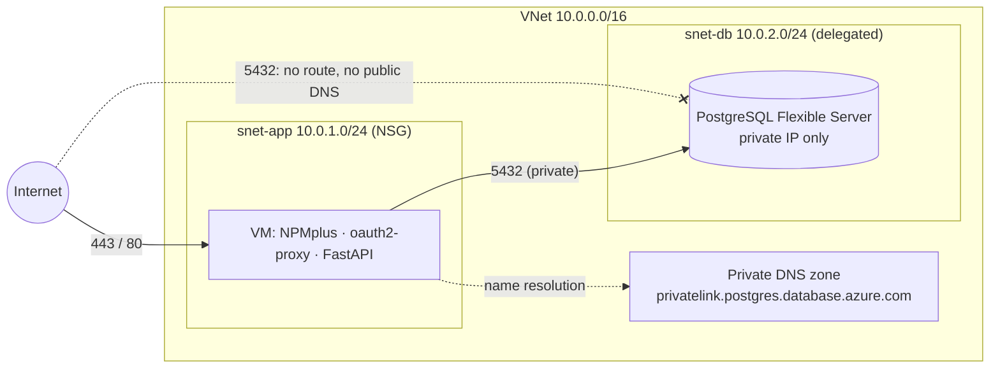

# 04 — Day 4: Data Isolation

**Findings addressed:** F-03 (public database, firewall open to all IPs),
F-04 (VM → DB over the public internet), partly F-16 (flat network).
Full command history: [walkthrough-log.md](walkthrough-log.md), Step 7.

## Problem and threat

The PostgreSQL Flexible Server had a public endpoint and a firewall rule
`allow-all` (`0.0.0.0`–`255.255.255.255`). Any host on the internet could
reach port 5432, so the only barrier was the `psqladmin` password, which
bots brute-force continuously. A successful login means full read, write
and drop on all data, without touching the VM, the WAF or the identity gate
of Days 1–3.

## Architecture after Day 4

## Changes (Terraform)

| File | Change | Why |
|---|---|---|
| `network.tf` | `azurerm_subnet.db` (10.0.2.0/24), delegated to `Microsoft.DBforPostgreSQL/flexibleServers` | The server is injected into its own subnet |
| `network.tf` | `azurerm_private_dns_zone.postgres` + VNet link | Inside the VNet the unchanged FQDN resolves to the private IP. Outside it does not resolve |
| `postgresql.tf` | `public_network_access_enabled = false`, `delegated_subnet_id`, `private_dns_zone_id` | No public endpoint at all |
| `postgresql.tf` | firewall rule `allow_all` **removed** | No exceptions to the isolation |
| `vm.tf` | `depends_on` no longer references the removed rule | Otherwise the plan fails |
| `network.tf` | NSG rules moved to standalone `azurerm_network_security_rule` resources (+ one-time `terraform import`) | See "Unexpected finding" below |

The FQDN in the app's connection string is built statically
(`psql-<prefix>.postgres.database.azure.com`), so replacing the database
**did not replace the VM**.

## Procedure (backup-first)

1. Evidence before: `nc` to 5432 from the Mac → `succeeded`; firewall rule `allow-all`.
2. **Backup** on the VM (`pg_dump`, 610 lines, both entries), then copied **off-host** to the Mac (`scp`).
3. `terraform plan`: checked that only the DB is replaced, not the VM, and that nothing unexpected changes.
4. `terraform apply`: 5 added, 3 destroyed (server replaced).
5. **Restore** through the VM (`psql -f`), count = 2.
6. Restart the app, check `/entries`.
7. Evidence after: `nc` from the Mac → the name does not resolve.
8. Delete the world-readable dump on the VM.

## Verification

| Check | Before | After |
|---|---|---|
| `nc -vz psql-ls-vladi.postgres.database.azure.com 5432` (Mac) | `succeeded` | `getaddrinfo: nodename nor servname provided` |
| Firewall rules | `allow-all 0.0.0.0–255.255.255.255` | none (rule removed) |
| `select count(*) from entries` after restore | 2 | 2 |
| App `/entries` (on the VM) | `count: 2` | `count: 2` |

## Unexpected finding: Terraform vs. the automated response

The pre-migration plan contained an unplanned
`azurerm_network_security_group.app will be updated in-place`. The cause
was a Deny rule `sentinel-block-45-45-237-39` (priority 100). The
**Sentinel auto-block playbook** (Day 5) had added it on its own, after the
external LFI scanner from Day 2 triggered the WAF-attack analytics rule.
With inline NSG rules, Terraform owned the whole rule set, so `apply` would
have **deleted the block and re-admitted the attacker**.

Fix: standalone `azurerm_network_security_rule` resources plus a one-time
`terraform import` of the three existing rules. Terraform now manages only
its own rules, and automated blocks survive every `apply`. This was only
visible because `terraform plan` had been made noise-free on Day 1.

## Problems hit

| Problem | Fix |
|---|---|
| `az postgres flexible-server firewall-rule list -n …` → `unrecognized arguments` | CLI 2.89 uses `--server-name` |
| `systemctl show -p Environment` returns the value quoted → `pg_dump: invalid connection option` | Read the URL from the unit file instead |
| ~75 `WARNING: no privileges were granted …` on restore | Harmless: Azure system-catalog ACLs in the dump. Use `pg_dump --no-acl` next time |
| `Permission denied (publickey)` mid-procedure | Entra SSH certificate expired, `az ssh config --overwrite` |

## Residual risk

- **The DB admin password is still in plaintext** in the systemd unit
  (world-readable, proven during the backup without `sudo`), in
  `custom_data` and in Terraform state (F-09). The app also uses the
  **admin** account (F-10). Next steps: a dedicated least-privilege app
  role, the secret in **Key Vault**, or **Entra ID authentication for
  PostgreSQL** with the VM's managed identity (no password at all).
- The migration was destructive and needed manual backup and restore. Azure
  keeps automated backups (PITR, 7 days by default), but a restore creates a
  new server. Geo-redundant backup is off.
- Private DNS: any resource in the VNet can reach 5432. An NSG on `snet-db`
  allowing only `snet-app` would add defense in depth.
- Production alternative: **Private Endpoint** (Private Link) if the server
  must be shared across VNets or subscriptions.
