# 05 — Day 5: Detection and Response

**Findings addressed:** F-14 (no detection or response).
Full command history: [walkthrough-log.md](walkthrough-log.md), Step 8.

## Problem and threat

Days 1–4 made the system harder to attack, but nobody would *notice* an
attack. Without detection, a scanner can probe for as long as it likes, and
every new hole found later is exploited silently. Without automated response,
even a detected attack waits for a human.

## The pipeline (deployed by `sentinel.tf` + `scripts/setup-json-logging.sh`)

```mermaid
graph LR
    N["NPMplus access.log"] --> F["npmplus-log-forwarder<br/>(JSON → syslog local0, tag nginx)"]
    F --> AMA["Azure Monitor Agent<br/>+ Data Collection Rule"]
    AMA --> LAW[("Log Analytics<br/>Syslog table")]
    LAW --> R["Sentinel scheduled rule<br/>≥5 × 403 per IP / 5 min<br/>(excludes 127.0.0.1)"]
    R --> I["Incident (High)"]
    I --> AR["Automation rule<br/>severity = High"]
    AR --> P["Logic App playbook<br/>(managed identity)"]
    P --> NSG["NSG Deny rule<br/>sentinel-block-&lt;ip&gt;, priority 100"]
```

Least privilege in the chain: the VM's identity can only publish to the DCR;
the playbook's identity is *Network Contributor* on **this NSG only** plus
*Sentinel Responder* on the workspace; Sentinel's service principal may only
trigger this one playbook.

## Evidence: a real attack, handled with no human involved

| Time (UTC) | Event | Evidence |
|---|---|---|
| 19:03:53–55 | External scanner `45.45.237.39` sends 24 LFI probes; WAF answers 403 | `cscli alerts list`; KQL: 24 blocks in 2 s |
| 19:14:07 | Sentinel incident #1 "WAF Attack — High Volume 403s from Single IP", **High** | `SecurityInsights/incidents` |
| 19:14:13–15 | Playbook run **Succeeded** (2.2 s), 6 s after the incident | Logic App `runs` |
| since then | `sentinel-block-45-45-237-39`: **Deny, priority 100, all ports** | `az network nsg rule list` |

**Time to respond: ~10 minutes** from attack to block (log ingestion plus the
5-minute schedule). The response itself took seconds.

KQL behind the rule, over the whole day:

| Source | 403s | Outcome |
|---|---|---|
| `45.45.237.39` | 24 | incident + block |
| `127.0.0.1` | 11 | ignored on purpose (our WAF blocking NPMplus admin calls via the tunnel) |
| operator IP | 3 | no incident: deliberate tests, below the threshold of 5 |

## Live controlled test (second IP: Azure Cloud Shell `134.149.156.75`)

| Request (unauthenticated) | Responses |
|---|---|
| `/entries?id=1+UNION+SELECT…` | `302` ×6 |
| `/oauth2/sign_in?rd=1+UNION+SELECT…` | `403` ×6 |

| Step | Result |
|---|---|
| Sentinel incident #2 | created 21:09:28 UTC, High |
| Playbook run | **Failed**: `SecurityRuleConflict`, "Rules cannot have the same Priority and Direction" |
| After the fix (PR #11) + `terraform apply` + resubmit | **Succeeded**: `sentinel-block-134-149-156-75`, Deny, priority **101** |
| `curl` from the blocked Cloud Shell IP | `000`: no TCP connection, dropped by the NSG |
| `curl` from the operator's Mac | `302`: legitimate user unaffected |

## Findings from Day 5

1. **The auto-block could only ever block one attacker.** The playbook
   hard-coded `"priority": 100`. The second block rule conflicted with the
   first (`SecurityRuleConflict`), so detection worked while the response
   silently failed. The real scanner happened to be first, which hid the bug
   until the controlled test. Fixed (PR #11): the playbook reads the NSG and
   uses the next free priority (100, 101, …), and the loop runs with
   concurrency 1.
2. **Detection blind spot caused by Day 3.** Unauthenticated attacks against
   the protected API get `302` from the identity gate *before* the WAF sees
   them. They produce no 403, so the 403-based rule never fires. Mitigation
   options: alert on bursts of 302 → `/oauth2/sign_in` per IP; evaluate AppSec
   before `auth_request`; or ship CrowdSec's own AppSec alerts (which see the
   payload) to Sentinel.
3. **IaC vs. automated response** (found on Day 4): inline NSG rules made
   Terraform delete the playbook's block rules on every `apply`. Fixed with
   standalone `azurerm_network_security_rule` resources.
4. **Threshold tuning matters.** Below 5 hits, testers and users are safe
   from self-blocking. The `127.0.0.1` exclusion prevents a meaningless
   "block localhost" response.
5. **Credentials in logs.** oauth2-proxy logs authorization codes in callback
   URLs, and these logs are now shipped to a central workspace.

6. **Azure-managed drift on the DB subnet.** Azure adds the `Microsoft.Storage`
   service endpoint to the delegated subnet, and Terraform would have removed
   it, which could break backups. Declared in code (PR #12).

## Residual risk

- Blocks are **permanent** (no expiry) and keyed on IP. Attackers rotate IPs,
  and shared IPs (NAT, VPN) can block innocent users. Production: a TTL on
  block rules, an allow-list, and a human review step for low-confidence
  incidents.
- NSG rules have hard limits (1,000 rules per NSG). A busy scanner wave could
  exhaust them. Production: Azure Firewall / Front Door WAF IP sets.
- Detection only on HTTP 403 volume. No detection for SSH (`auth`/`authpriv`
  are collected but have no rule), slow attacks under the threshold, or
  data access anomalies.
- ~10 minutes to respond is fine for scanners, too slow for a targeted
  exploit. NRT (near-real-time) rules would cut this.
- Incidents #1 and #2 are still **New**. An analyst should triage it, close it and
  document the outcome.
