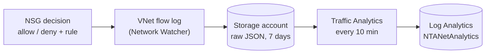

# 06 — Network Visibility: VNet Flow Logs

**Gap addressed:** traffic dropped by the NSG was not recorded anywhere
(see [05](05-detection-response.md), "Residual risk", and the "what is not
visible" list in the README).
Deployed by `flowlogs.tf` + `templates/vnet-flow-log.json`.

## Problem

The NSG is the first and the strictest layer: it drops every port except
80/443, SSH from anyone but `admin_source_ip`, and every IP that Sentinel
blocked (`sentinel-block-*`). That is where most "attack attempts" end, and
until now none of it was logged:

| What the NSG drops | Visible before? |
|---|---|
| Port scans (22, 3389, 5432, 8080, …) | no |
| SSH attempts from IPs other than the operator's | no |
| Repeat visits of IPs already blocked by Sentinel | no |

So the question "how many attacks per day?" could only be answered for the
HTTP traffic that got past the NSG.

## Change



| Resource | Why |
|---|---|
| VNet flow log on `vnet-<prefix>` (ARM template in `NetworkWatcherRG`) | Records every flow in both subnets with the NSG verdict and the rule (`AclRule`) |
| `azurerm_storage_account.flowlogs` | Azure writes raw flow logs to a storage account (required); TLS 1.2, no public blobs, 7-day retention |
| Traffic Analytics → `law-<prefix>` | Aggregates flows, adds country and a threat-intel flag (`FlowType == "MaliciousFlow"`) |
| 3 saved searches, category *Network* | Inbound flows per day, top denied IPs, denied ports by rule |

**Why VNet flow logs and an ARM template:** Azure no longer allows creating
new *NSG* flow logs (retirement; they are deleted on 30 Sep 2027). VNet flow
logs are the replacement. The pinned azurerm 3.x provider only supports NSG
flow logs, and moving to azurerm 4.x is a separate migration, so the flow
log is a small ARM template (same pattern as the Sentinel playbook).

## Queries

Attacks per day at the network layer:

```kql
NTANetAnalytics
| where TimeGenerated > ago(30d)
| where SubType == "FlowLog" and FlowDirection == "I"
| where FlowType in ("ExternalPublic", "MaliciousFlow")
| summarize DeniedFlows = sum(DeniedInFlows), DeniedSsh = sumif(DeniedInFlows, DestPort == 22),
            BlockedByRule = sumif(DeniedInFlows, AclRule has "sentinel-block")
  by Day = startofday(TimeGenerated)
| order by Day desc
```

Together with the HTTP layer (`CrowdSecAlerts`, 403s in `Syslog`) this gives
the full picture of one day.

## Verification

```bash
az network watcher flow-log list --location westeurope -o table
```

Expected: `fl-vnet-<prefix>`, enabled, target `vnet-<prefix>`, Traffic
Analytics interval 10. The first rows in `NTANetAnalytics` appear after
roughly 20–60 minutes (flow log write + Traffic Analytics processing).

## Residual risk / notes

- **Delay:** Traffic Analytics runs every 10 minutes on top of the flow log
  write interval. Good for statistics and hunting, not for real-time response.
- **Cost:** VNet flow logs and Traffic Analytics are billed per GB processed.
  For one small VM this is a few cents to a few euros per month.
- **Aggregation:** flows are counted, not packets or connection attempts
  one by one; a scanner that sends several SYNs on one 4-tuple counts as one flow.
- The SSH attempts *allowed* from `admin_source_ip` are still logged by
  `sshd` (`auth` → `Syslog`); denied ones now appear here.
