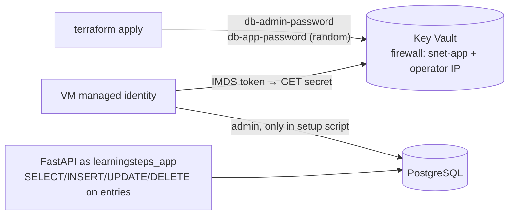

# 07 — Secrets: Key Vault and a Least-Privilege DB Role

**Findings addressed:** F-09 (DB password in plaintext), F-10 (app uses the
DB admin account), F-08 (API bound to `0.0.0.0` at boot).
Deployed by `keyvault.tf` + `scripts/setup-db-secrets.sh` (embedded into
`scripts/cloud-init.yaml` by `vm.tf`).

## Problem and threat

| Where the admin password was | Who could read it |
|---|---|
| systemd unit `Environment=DATABASE_URL=…` | **every local user** (unit files are world-readable) |
| VM `custom_data` | anyone with read access to the VM in Azure, and every process on the VM via cloud-init's copies |
| Terraform state / `terraform.tfvars` | whoever has the operator's laptop (F-15) |

And the app itself connected **as the admin** (F-10): a single SQL injection
or RCE in the app would mean full control of the database (drop tables,
create roles, read everything).

## Change



| Piece | What it does |
|---|---|
| `azurerm_key_vault.main` | Holds `db-admin-password` and `db-app-password`. Firewall: `default_action = Deny`, only `snet-app` (service endpoint `Microsoft.KeyVault`) and `admin_source_ip` |
| Access policies | Operator: manage secrets. VM identity: **Get** only. (Policies, not RBAC, so the first `apply` does not fail on RBAC propagation) |
| `random_password.db_app` | 32-character password for the app role, generated by Terraform |
| `setup-db-secrets.sh` | On the VM: reads both secrets via the managed identity, applies `database_setup.sql`, creates/updates `learningsteps_app` with only `SELECT, INSERT, UPDATE, DELETE` on `entries`, writes a unit **without** secrets |
| `/usr/local/bin/learningsteps-start` | Fetches the app password at every start and passes it to uvicorn in the environment only; binds to `127.0.0.1` (F-08) |
| `cloud-init.yaml` | No password any more, only the vault name and DB coordinates; runs the same script on first boot |
| `vm.tf` | `custom_data` in `ignore_changes`: changing it would **replace** the VM and wipe NPMplus/oauth2-proxy/CrowdSec |

Tested against a local PostgreSQL 16 with a non-superuser `CREATEROLE`
admin (like Azure's): the role can read and write rows but gets
`must be owner` / `permission denied` for `DROP TABLE`, `ALTER TABLE`,
`TRUNCATE`, `CREATE TABLE` and `CREATE ROLE`; re-running the script is
idempotent and applies a rotated password. This test also caught a bug:
`ALTER ROLE … NOSUPERUSER` fails for a non-superuser admin, so the script
does not set it (a `CREATEROLE` admin cannot create a superuser anyway).

## Migrating the existing VM

1. Apply the Terraform changes:
   ```bash
   terraform init -upgrade
   terraform plan
   ```
   Expected: **add** `random_password.db_app`, `azurerm_key_vault.main`,
   `azurerm_key_vault_access_policy.vm`, two `azurerm_key_vault_secret`;
   **update in place** `azurerm_subnet.app` (service endpoint). The VM must
   **not** be replaced. Then `terraform apply`.
2. Run the script on the VM (same code as cloud-init):
   ```bash
   scp -F azssh_config scripts/setup-db-secrets.sh <vm-ip>:/tmp/
   ssh -F azssh_config <vm-ip> "$(terraform output -raw db_secrets_setup_command)"
   ```
   It ends with `Done. API is up, connected as learningsteps_app.`
3. Verify:
   ```bash
   ssh -F azssh_config <vm-ip> "systemctl cat learningsteps | grep -ci password; sudo tr '\0' '\n' < /proc/\$(pgrep -f 'uvicorn main:app')/environ | grep -o 'postgresql://[^:]*'"
   ```
   Expected: `0` and `postgresql://learningsteps_app`.
4. **Rotate the admin password.** The old one is still in the VM's
   `custom_data`, in cloud-init's copies on the VM and in old state/tfvars
   backups. Change `db_admin_password` in `terraform.tfvars`, then
   `terraform apply`: this updates the PostgreSQL server and the Key Vault
   secret in place (no VM replacement, `custom_data` is ignored). The old
   value is then useless everywhere.

## Residual risk

- **Managed identity = any process on the VM.** Every local process can ask
  IMDS for a token and read both secrets. The gain is that nothing is on
  disk, in a unit file or in Azure metadata, and access is logged in Key
  Vault; a VM compromise still exposes the secrets.
- **Terraform state** still contains both passwords (F-15). Fix: remote
  `azurerm` backend with RBAC (`backend.tf.example`).
- **Key Vault firewall** follows `admin_source_ip`: if the operator's IP
  changes, `terraform plan` fails with 403 until the variable is updated,
  the same as SSH.
- **No password at all** would need Entra ID authentication for PostgreSQL;
  the app would have to refresh the access token (1 h), which needs a change
  in the upstream app.
- The app role still may `DELETE` every row (`DELETE /entries`); that is an
  authorization issue in the app (F-17), not a DB privilege issue.
